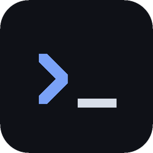

<p align="center">
  
</p>

<h1 align="center">term7</h1>

<p align="center">
  A modern Linux terminal built around your GitHub and Claude Code workflow.
</p>

<p align="center">
  <a href="https://github.com/code7tecbr/term7/releases/latest">Download</a>
  ·
  <a href="CONTRIBUTING.md">Contributing</a>
  ·
  <a href="https://github.com/code7tecbr/term7/issues">Issues</a>
  ·
  <a href="README.pt-BR.md">Português</a>
</p>

<h1></h1>

## About

term7 is a desktop terminal made with **Tauri 2** (Rust backend) and **Vue 3 + TypeScript**, rendering with
**xterm.js** on WebGL. Besides being a fast terminal with vertical tabs, it understands what is running inside
each tab: the pull request of your branch, the state of your GitHub Actions, and what Claude Code is doing,
including its subagents, MCP servers and usage limits.

> [!NOTE]
> term7 grew out of one developer's daily workflow: **Linux + GitHub (`gh`) + Claude Code**. That combination
> is used every day and works well. Other setups (other distros, desktops, Git hosts or AI CLIs) are less
> tested, so bug reports about them are very welcome.

## Highlights

**Tabs that know what is going on**
- Vertical tabs with name, color and a stage tag (discovery, spec, design, plan, code, review, request-change,
  rework, test, approve, close/merge), also on tab groups. Drag and drop, collapse groups, session restored on reopen.
- A bottom terminal per tab (`Ctrl+'`), a file explorer with git status (`Ctrl+Shift+G`) and files opened in
  tabs, with *file*, *changes* (diff against the last commit) and *preview* (Markdown/HTML) modes.
- Clickable links and file paths in the output: they open the file at the right line.

**GitHub**
- The status bar shows the branch, the PR and its checks, and the GitHub Actions runs. It also tells you when
  you are in a worktree. Switch branches from there.
- The tab tag follows the PR on its own: request-change when a review asks for changes, approve when it is
  approved, close/merge when it is merged. Changing the tag by hand sticks until the PR changes again.

**Claude Code**
- The tab shows when Claude is working, waiting for you or done (via hooks).
- Subagents menu, the MCP servers of the tab's project (connected, needs auth, failed) and commands
  suggested by Claude as ▶ buttons, ready to run in the bottom terminal.
- Usage in the top bar: context window, 5-hour and weekly limits, and per-model limits.
- Review comments: select lines of a file or a diff (removed lines included), write what Claude should do, and
  send them all to the tab's Claude as one paste.

**Also**
- Voice dictation: any OpenAI-compatible API (Groq is preset) or local [whisper.cpp](https://github.com/ggml-org/whisper.cpp).
- Anonymous mode: scrambles all text on screen so you can record without exposing anything.
- In-app updates when a new release comes out.

## Installation

term7 ships as a `.deb` built on Ubuntu 24.04. It installs on Ubuntu 24.04 or newer, including Pop!_OS 24.04.

1. Download the `.deb` from the [latest release](https://github.com/code7tecbr/term7/releases/latest).
2. Install it. `git` and `gh` come along as dependencies:
   ```sh
   sudo apt install ./term7_*.deb
   ```
3. Log in to GitHub once, so term7 can show PRs and actions:
   ```sh
   gh auth login
   ```

When a new release is out, **Update to vX** shows up next to the version in the status bar.

## Building from source

You need Node 24+ and either Docker (recommended: no Rust on your machine) or Rust with the Tauri libraries.

```sh
npm install
npm test                          # frontend unit tests
npm run build                     # type-check + frontend build
docker compose run --rm build     # builds the .deb into dist-deb/ (same Ubuntu 24.04 as CI)
scripts/install-local.sh          # installs that .deb in ~/.local, no sudo
```

Rust checks and tests also run in the container:

```sh
docker compose run --rm --no-deps dev bash -c "cd src-tauri && cargo check && cargo test"
```

See [CONTRIBUTING.md](CONTRIBUTING.md) for the native setup, the branch flow and how releases work, and
[CLAUDE.md](CLAUDE.md) for the code structure and conventions.

## Contributing

Contributions are welcome. Before opening an issue, [search the existing ones](https://github.com/code7tecbr/term7/issues),
then use one of the [templates](https://github.com/code7tecbr/term7/issues/new/choose). Pull requests go to the
`dev` branch. The full flow is in [CONTRIBUTING.md](CONTRIBUTING.md).

Security issues should be reported privately, as described in [SECURITY.md](SECURITY.md).

If you use Claude Code, the repo includes project skills in `.claude/skills/` that teach it how to build,
test and contribute to term7.

## Roadmap

Planned work lives in the [issues](https://github.com/code7tecbr/term7/issues): command blocks, a command
palette, themes, file editing, macOS and Windows, and a v2 with native GPU rendering in Rust.

## Code of conduct

Everyone is expected to be respectful and kind. See the [Code of Conduct](CODE_OF_CONDUCT.md).

## License

term7 is licensed under the [MIT license](LICENSE). The licenses of the bundled open source dependencies are
installed with the app at `/usr/share/doc/term7/THIRD_PARTY_LICENSES.md`.

Built on the shoulders of [Tauri](https://tauri.app), [xterm.js](https://xtermjs.org), [Vue](https://vuejs.org),
[CodeMirror](https://codemirror.net) and [portable-pty](https://crates.io/crates/portable-pty), among others.

<sub>Claude is a trademark of Anthropic. GitHub is a trademark of GitHub, Inc. term7 is an independent project,
not affiliated with or endorsed by either.</sub>
