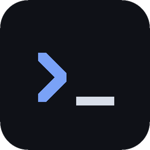

<p align="center">
  
</p>

<h1 align="center">term7</h1>

<p align="center">
  Um terminal moderno pra Linux, feito em volta do seu fluxo com o GitHub e o Claude Code.
</p>

<p align="center">
  <a href="https://github.com/code7tecbr/term7/releases/latest">Download</a>
  ·
  <a href="CONTRIBUTING.pt-BR.md">Como contribuir</a>
  ·
  <a href="https://github.com/code7tecbr/term7/issues">Issues</a>
  ·
  <a href="README.md">English</a>
</p>

<h1></h1>

## Sobre

O term7 é um terminal desktop feito com **Tauri 2** (backend em Rust) e **Vue 3 + TypeScript**, renderizado
pelo **xterm.js** com WebGL. Além de ser um terminal rápido com abas na lateral, ele entende o que está rodando
em cada aba: o PR da sua branch, o estado das GitHub Actions e o que o Claude Code está fazendo, com os
subagentes, os servidores MCP e os limites de uso.

> [!NOTE]
> O term7 nasceu do dia a dia de um desenvolvedor: **Linux + GitHub (`gh`) + Claude Code**. Essa combinação é
> usada todo dia e funciona bem. Outros cenários (outras distros, desktops, hosts de Git ou CLIs de IA) foram
> menos testados, então relatos de bug sobre eles são muito bem-vindos.

## Destaques

**Abas que sabem o que está acontecendo**
- Abas na lateral com nome, cor e tag de etapa (discovery, spec, design, plan, code, review,
  request-change, rework, test, approve, close/merge), também nos grupos. Uma aba ou um grupo inteiro também pode ser pausado, junto com a tag, pra deixar de lado por enquanto. Arrastar e soltar, recolher grupos, sessão restaurada ao reabrir.
- Terminal inferior por aba (`Ctrl+'`), explorador de arquivos com o status do git (`Ctrl+Shift+G`) e arquivos
  abertos em abas, nos modos *arquivo*, *alterações* (diff com o último commit) e *visualizar* (Markdown/HTML).
- Links e caminhos de arquivo clicáveis na saída: abrem o arquivo na linha certa.

**GitHub**
- A barra de status mostra a branch, o PR e os checks dele, e as runs das GitHub Actions. Também avisa quando
  você está numa worktree. A troca de branch é feita por ali.
- A tag da aba acompanha o PR sozinha: request-change quando um review pede alterações, approve quando é
  aprovado, close/merge quando é mergeado. A troca feita na mão fica até o PR mudar de novo.

**Claude Code**
- A aba mostra quando o Claude está trabalhando, esperando você ou terminou (via hooks).
- Menu de subagentes, os servidores MCP do projeto da aba (conectados, precisam de autenticação, falharam) e
  os comandos que o Claude sugeriu como botões ▶, prontos pra rodar no terminal de baixo.
- Uso na barra de cima: janela de contexto, limites de 5 horas e da semana, e limites por modelo.
- Comentários de revisão: selecione linhas de um arquivo ou de um diff (inclusive as removidas), escreva o que
  o Claude deve fazer e mande todos de uma vez, como uma colagem, pro Claude da aba.

**Também**
- Ditado por voz: qualquer API compatível com a da OpenAI (a Groq vem preenchida) ou o
  [whisper.cpp](https://github.com/ggml-org/whisper.cpp) local, sem nada sair da máquina.
  Terminar a fala com “enviar” manda com Enter.
- Leitura em voz alta: a resposta do Claude é lida quando ele termina (sempre, ou só depois de um ditado),
  pela mesma API do ditado ou por outra (a OpenAI fala português; a voz do Groq, só inglês).
- Modo anônimo: embaralha todo o texto da tela, pra gravar sem expor nada.
- Atualização pelo próprio app quando sai uma release nova.

## Instalação

O term7 é distribuído como `.deb`, compilado no Ubuntu 24.04. Instala no Ubuntu 24.04 ou mais novo, incluindo
o Pop!_OS 24.04.

1. Baixe o `.deb` da [última release](https://github.com/code7tecbr/term7/releases/latest).
2. Instale. O `git` e o `gh` vêm junto, como dependências:
   ```sh
   sudo apt install ./term7_*.deb
   ```
3. Faça login no GitHub uma vez, pra o term7 mostrar PRs e actions:
   ```sh
   gh auth login
   ```

Quando sai uma release nova, aparece **Atualizar pra vX** ao lado da versão, na barra de status.

### Extensões

Complementos opcionais ficam em [`extensions/`](extensions/README.pt-BR.md) e são instalados à parte. Eles falam com
o term7 por uma API local, desligada por padrão (**Configurações > Extensões**). Disponíveis: um servidor MCP que
deixa o Claude Code listar suas abas, ler a tela delas e mandar mensagem pro Claude de outra aba, e um indicador na
barra de status pro [statusbot](https://github.com/wisley7l/statusbot).

## Compilando

Você precisa do Node 24+ e do Docker (recomendado: não precisa de Rust na máquina) ou do Rust com as
bibliotecas do Tauri.

```sh
npm install
npm test                          # testes do frontend
npm run build                     # checa os tipos e compila o frontend
docker compose run --rm build     # gera o .deb em dist-deb/ (mesmo Ubuntu 24.04 do CI)
scripts/install-local.sh          # instala esse .deb em ~/.local, sem sudo
```

As checagens e os testes do Rust também rodam no container:

```sh
docker compose run --rm --no-deps dev bash -c "cd src-tauri && cargo check && cargo test"
```

Veja o [CONTRIBUTING.pt-BR.md](CONTRIBUTING.pt-BR.md) pra montar o ambiente nativo, o fluxo de branches e como
saem as releases, e o [CLAUDE.md](CLAUDE.md) pra estrutura do código e as convenções.

## Como contribuir

Contribuições são bem-vindas. Antes de abrir uma issue, [procure nas que já existem](https://github.com/code7tecbr/term7/issues)
e depois use um dos [modelos](https://github.com/code7tecbr/term7/issues/new/choose). Pull requests vão pra
branch `dev`. O fluxo completo está no [CONTRIBUTING.pt-BR.md](CONTRIBUTING.pt-BR.md).

Falhas de segurança devem ser relatadas em particular, como explica o [SECURITY.md](SECURITY.md).

Se você usa o Claude Code, o repositório traz skills do projeto em `.claude/skills/`, que ensinam ele a
compilar, testar e contribuir com o term7.

## Roadmap

O que está planejado fica nas [issues](https://github.com/code7tecbr/term7/issues): blocos de comando, paleta
de comandos, temas, edição de arquivos, macOS e Windows, e uma v2 com renderização nativa em Rust, pela GPU.

## Código de conduta

Esperamos respeito e gentileza de todo mundo. Veja o [Código de Conduta](CODE_OF_CONDUCT.md).

## Licença

O term7 é distribuído sob a [licença MIT](LICENSE). As licenças das dependências open source que vão junto
são instaladas com o app em `/usr/share/doc/term7/THIRD_PARTY_LICENSES.md`.

Feito sobre os ombros do [Tauri](https://tauri.app), [xterm.js](https://xtermjs.org), [Vue](https://vuejs.org),
[CodeMirror](https://codemirror.net) e [portable-pty](https://crates.io/crates/portable-pty), entre outros.

<sub>Claude é marca registrada da Anthropic. GitHub é marca registrada da GitHub, Inc. O term7 é um projeto
independente, sem vínculo com nenhuma das duas nem endosso delas.</sub>
